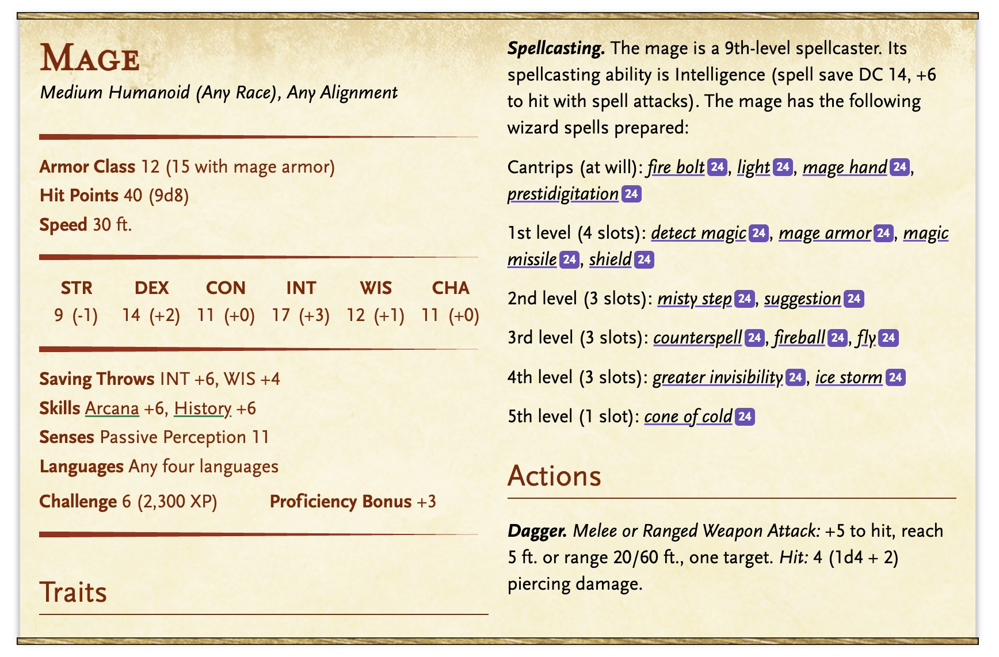
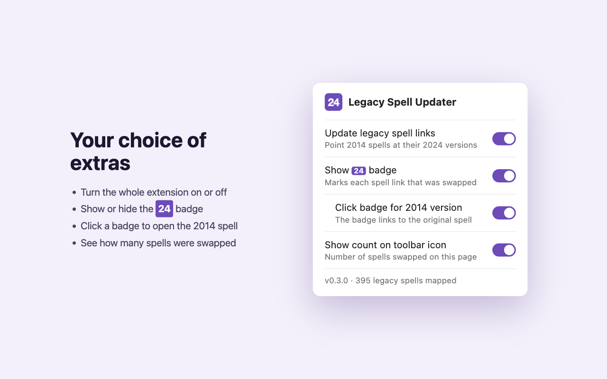

<p align="center">
  
</p>

<h1 align="center">Legacy Spell Updater for D&amp;D Beyond</h1>

<p align="center">
  A Chrome extension that points legacy (2014) spell links on D&amp;D Beyond monster stat blocks at
  their 2024 (5.5e) versions.
</p>



Many monsters on D&D Beyond still use 2014 stat blocks, and their spell lists link to the 2014
spells. If your table plays with the 2024 rules, every hover and click shows you the wrong spell
text. This extension fixes that on the page:

- **Links and tooltips**: each legacy spell link opens and previews the 2024 version.
- **The 24 badge**: a small purple **24** marks each swapped spell. Click it to open the original
  2014 spell.
- **Toolbar count**: the extension icon shows how many spells were swapped on the current page.
- **Where it works**: monster pages (`/monsters/…`) and the encounter builder's stat blocks. It
  also runs on encounter pages and the combat tracker, which use the same stat block markup but
  haven't been tested.
- **Beyond20**: if you use [Beyond20](https://beyond20.here-for-more.info/), its spell buttons
  roll the 2024 spell as well.
- **Leaves the rest alone**: 2024 stat blocks already link to 2024 spells, so they're skipped.
  Spells with no 2024 Player's Handbook version, such as *Absorb Elements*, keep their legacy link
  and get no badge. Character sheets aren't touched, because a character's spells are a choice the
  player made.

Every feature can be turned off. See [Settings](#settings).

## Install

The extension isn't on the Chrome Web Store yet, so you load it from this repo:

1. Download this repo: **Code → Download ZIP** and unzip it, or `git clone` it.
2. Open `chrome://extensions` and turn on **Developer mode** (top right).
3. Click **Load unpacked** and select the `extension/` folder (not the repo root).
4. Open a legacy monster, such as the
   [Archmage](https://www.dndbeyond.com/monsters/16789-archmage), and look for the **24** badges.

Optional: pin the extension from the puzzle-piece menu so its settings and the swap count are
always visible.

This should also work in other Chromium browsers that support unpacked extensions, such as Edge,
Brave and Arc.

## Settings

Click the extension's toolbar icon to open its settings:



| Setting | Default | What it does |
| --- | --- | --- |
| Update legacy spell links | On | The master switch. Turning it off restores the original 2014 links and removes the badges. |
| Show **24** badge | On | Shows or hides the badge next to swapped spell links. Links are still swapped when the badge is hidden. |
| Click badge for 2014 version | On | Makes each badge a link to the original 2014 spell. Off, the badge is just a label. |
| Show count on toolbar icon | On | Shows the number of swapped spells on the current page on the extension icon. |

Changes apply right away to any open D&D Beyond tabs, with no page refresh. Settings sync across
the Chrome browsers you're signed into.

## How it works

- `extension/spell-map.json` maps each legacy spell ID to its 2024 `id-slug`, for example
  `"1989": "2618844-acid-splash"`.
- `extension/content.js` runs on D&D Beyond's monster, encounter builder, encounter and combat
  tracker pages. In each `.mon-stat-block`, it reads the spell ID from every `a.spell-tooltip`
  link. If the map has a 2024 version, it rewrites the link's `href` and `data-tooltip-href` and
  adds the badge. It keeps the original values so it can undo the swap when you turn the extension
  off. A `MutationObserver` catches stat blocks that load later, such as the encounter builder's
  expandable rows, and the spell icons Beyond20 inserts.
- `extension/background.js` puts the swap count on the toolbar icon.
- `extension/popup.html` / `popup.js` hold the settings, saved with `chrome.storage.sync`.

The map ships with the extension, so the extension makes no network requests of its own. It only
reads the D&D Beyond page you're already viewing.

## Regenerate the spell map

The map is a snapshot of D&D Beyond's spell list. Rebuild it when spells are added or renamed, or
if some legacy spells stop getting a badge. A [GitHub Action](#automatic-map-updates) also does
this once a month.

**Requirements:** [Node.js](https://nodejs.org/) 18 or newer. There are no npm dependencies to
install.

1. From the repo root, run:

   ```sh
   node scripts/build-spell-map.mjs
   ```

   The script reads the public spell listing at https://www.dndbeyond.com/spells. You don't need
   to be logged in. It fetches one page per second to be polite, so it takes about a minute. It
   prints its progress and finishes with a summary in this shape:

   ```
   2024 spells: <n>, other spells: <n>, mapped: <n>
   Other spells with no 2024 PHB version: <n>
   ```

   The current map has 395 entries.

   Options:

   - `--verbose` also lists every legacy spell that has no 2024 match.
   - `--force` writes the map even if it shrank (see below).

   **Safety check:** if the new map has more than 10% fewer spells than the current one, the script
   refuses to write it and exits with an error. That usually means D&D Beyond changed its page
   markup or blocked the requests, not that spells disappeared. Use `--force` only once you've
   confirmed the smaller map is correct.

2. Check the result with `git diff extension/spell-map.json`. The script overwrites the file
   in place.

3. **Reload the extension in Chrome.** Chrome doesn't pick up the new map until you do:
   1. Open `chrome://extensions`.
   2. Find **Legacy Spell Updater for D&D Beyond** and click its reload button (↻).
   3. **Refresh any D&D Beyond tabs you already have open.** Those tabs are still running the old
      copy of the extension and won't pick up the new map until you refresh them.

   The settings popup shows how many spells are mapped, so you can confirm the new map loaded.

### How spells are matched

The script collects the 2024 spells (2024 Player's Handbook and the 2024 Free Rules) and all other
spells, then matches them by URL slug. When a spell was renamed between editions, add the legacy
slug → 2024 slug pair to `scripts/aliases.json`:

```json
{
  "acid-arrow": "melfs-acid-arrow",
  "feeblemind": "befuddlement"
}
```

To find a missing pair, run with `--verbose`, look up the 2024 spell on D&D Beyond, and take the
slug from its URL (the part after the ID: `/spells/2619032-melfs-acid-arrow` → `melfs-acid-arrow`).
Then rerun the script and reload the extension.

## Automatic map updates

`.github/workflows/update-spell-map.yml` rebuilds the map at 09:00 UTC on the 1st of every month.
If the map changed, it opens a pull request named **Update spell map**. If the map shrank by more
than 10%, the run fails instead and GitHub emails you. You can also run it any time from the
repo's **Actions** tab → **Update spell map** → **Run workflow**.

One-time setup: in the repo's **Settings → Actions → General**, under **Workflow permissions**,
check **Allow GitHub Actions to create and approve pull requests**. Without it, the rebuild works
but the pull request step fails.

**Cost:** GitHub-hosted runners are free for public repositories. Each run takes a couple of
minutes, so a private repo stays far inside GitHub's free monthly minutes.

After you merge one of these pull requests, pull it and reload the extension as in step 3 above.

## Publishing to the Chrome Web Store

Everything the store asks for is in [`store/`](store/LISTING.md): the description, permission
justifications, privacy answers, and the screenshots and promo tile at the right sizes. To build
the upload:

```sh
sh scripts/package.sh   # writes dist/legacy-spell-updater-<version>.zip
```

Bump `version` in `extension/manifest.json` before each upload. See
[`store/LISTING.md`](store/LISTING.md) for the step-by-step.

## Troubleshooting

- **No badges anywhere.** Make sure you're on a *legacy* monster. 2024 monsters already link to
  2024 spells. Also check that the extension and the badge setting are on in the popup, and that
  the extension is enabled in `chrome://extensions`.
- **One spell has no badge.** It may have no 2024 PHB version, which is expected. Or it may have
  been renamed. Run the map script with `--verbose` and add an alias if needed.
- **The extension stopped working after a reload or update.** Refresh the D&D Beyond tab.
- **The map script fails with an HTTP error or the safety check.** D&D Beyond may be
  rate-limiting or may have changed its page layout. Wait a few minutes and try again. If the
  script reports `+0` on the first page, the page markup has probably changed and the `data-slug`
  pattern in the script needs updating.

## Project layout

```
extension/              the unpacked Chrome extension (load this folder)
  manifest.json
  content.js/.css       rewrites links and adds the badge
  background.js         toolbar swap count
  popup.html/.js        settings popup
  spell-map.json        generated: legacy spell ID → 2024 id-slug
  icons/
scripts/
  build-spell-map.mjs   regenerates extension/spell-map.json
  aliases.json          renamed spells: legacy slug → 2024 slug
  package.sh            zips extension/ for the Chrome Web Store
store/                  Chrome Web Store listing text and images
.github/workflows/      monthly spell map update
images/                 README screenshots
```

## Privacy

The extension only runs on D&D Beyond's monster, encounter builder, encounter and combat tracker
pages. It asks for one permission, `storage`, to save your settings. It sends no data anywhere,
uses no analytics, and doesn't read your D&D Beyond account. See [PRIVACY.md](PRIVACY.md).

## License

[MIT](LICENSE)

---

_Unofficial fan project. Not affiliated with or endorsed by D&D Beyond or Wizards of the Coast.
Dungeons & Dragons and D&D Beyond are trademarks of Wizards of the Coast LLC._
